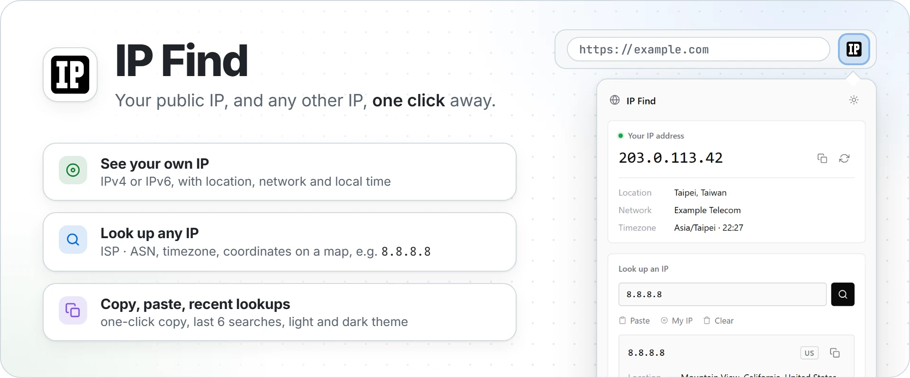
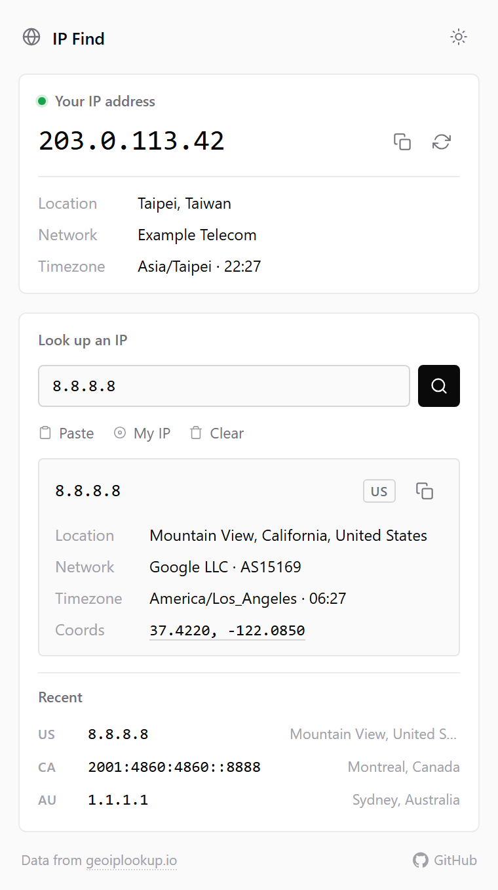
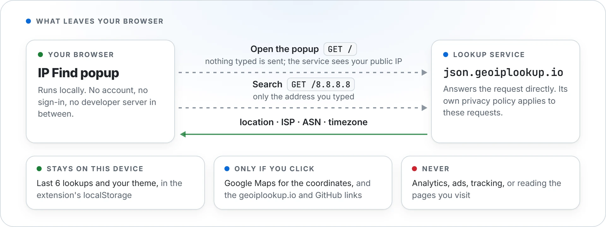

<p align="center">
  <picture>
    <source media="(prefers-color-scheme: dark)" srcset="docs/images/hero-dark.webp">
    
  </picture>
</p>

<p align="center">
  <a href="https://github.com/NatLee/ip-find-chrome-extension/actions/workflows/ci.yml"></a>
  <a href="https://chromewebstore.google.com/detail/ip-find/mjajkngihnkkbddplmehnaccpkelpeem"></a>
  <a href="https://chromewebstore.google.com/detail/ip-find/mjajkngihnkkbddplmehnaccpkelpeem"></a>
  <a href="LICENSE"></a>
</p>

IP Find is a small browser extension for Chrome and Edge that answers "what's my IP?" in one click. Open
the popup and it shows your public IPv4 or IPv6 address with its city, network and local time. Type or
paste any other address to see its location, ISP and AS number, timezone and a map link. It is plain
JavaScript with no dependencies and only two permissions, both for the clipboard. Location data comes
from [geoiplookup.io](https://geoiplookup.io).

## Install

**From the Chrome Web Store:** [IP Find](https://chromewebstore.google.com/detail/ip-find/mjajkngihnkkbddplmehnaccpkelpeem).
Edge can install it from the same page once you turn on *Allow extensions from other stores*.

**From source** (to try a change before it is in the store):

1. Clone this repo: `git clone https://github.com/NatLee/ip-find-chrome-extension.git`
2. Open `chrome://extensions` (or `edge://extensions`) and switch on **Developer mode**.
3. Click **Load unpacked** and pick the `src` folder.

After you edit a file, press the reload button on the extension's card and open the popup again.

## Usage

Click the IP Find button in the toolbar (pin it from the puzzle-piece menu if you don't see it).

<p align="center">
  <picture>
    <source media="(prefers-color-scheme: dark)" srcset="docs/images/popup-dark.png">
    
  </picture>
</p>
<p align="center"><sub>A real screenshot. The "Your IP address" card shows an example address from the documentation range instead of a real one.</sub></p>

- **Your IP address** loads as soon as the popup opens: location, network and the local time. Use the
  copy button to put the address on the clipboard, or the refresh button to check again (handy after
  you switch VPN or Wi-Fi).
- **Look up an IP**: type or paste an IPv4 or IPv6 address and press Enter or the search button.
  *Paste* fills the box from the clipboard and *My IP* looks up your own address. The result shows
  the location, the network (ISP and AS number), the timezone with its current time, and coordinates.
  Click the coordinates to open them in Google Maps.
- **Recent** keeps your last 6 lookups. Click one to run it again, or press *Clear* to forget them.
- The sun/moon button switches between light and dark. By default the popup follows your system
  theme.

Private and reserved addresses (192.168.x.x, 10.x.x.x, ::1 and so on) have no public location, so IP
Find says so instead of showing an empty card.

## Permissions

| Permission | What it is for |
|---|---|
| `clipboardWrite` | The copy buttons put an IP address on your clipboard. |
| `clipboardRead` | The *Paste* button reads an IP address from your clipboard. |

Both happen only when you click the button. IP Find has no host permissions, so it cannot read or
change the pages you visit. It runs only in its own popup.

## Privacy

<p align="center">
  <picture>
    <source media="(prefers-color-scheme: dark)" srcset="docs/images/privacy-dark.webp">
    
  </picture>
</p>

The popup talks to one service, `json.geoiplookup.io`, directly from your browser. There is no
developer server in between, and nothing is collected or tracked. Your recent lookups and your theme
choice stay in the extension's local storage on your computer. The full policy is in
[PRIVACY.md](PRIVACY.md).

## Development

You need Node.js 20 or newer, but only for the checks. The extension itself has no build step and no
dependencies.

```bash
npm test         # unit tests for src/lookup.js (node:test)
npm run check    # manifest, file references, icon sizes, no inline/remote scripts, syntax,
                 # and the permissions and remote hosts allowed by scripts/extension-policy.json
```

CI runs both on every pull request.

```
src/
├── manifest.json   Manifest V3: popup, icons and the two clipboard permissions
├── popup.html      the popup
├── popup.css       styles, light and dark
├── popup.js        DOM, events, history, clipboard
├── lookup.js       pure helpers: validation, API URL, formatting a response
└── icons/          16, 32, 48 and 128 px, rendered from assets/icon.svg
assets/icon.svg               the one source of the icon
scripts/check-extension.js    the checks behind `npm run check` (policy: scripts/extension-policy.json)
scripts/render-icons.mjs      renders the icon into every size the manifest lists
scripts/lib/browser.mjs       starts Edge/Chrome for the image scripts
docs/images/src/              sources for the README images
```

To change the icon, edit `assets/icon.svg` and run `node scripts/render-icons.mjs`. It writes every PNG
the manifest lists, at the size each entry names.

The README images come from the real popup. `node docs/images/src/popup-screenshots.mjs` takes
`popup-light.png` and `popup-dark.png`. `hero.html` and `privacy.html` are rendered with a headless
browser; the command is in each file's header. Both scripts use Edge or Chrome, whichever is installed
(set `BROWSER` to pick one), and load the extension through the DevTools protocol.

### Packaging and releases

`./package.sh` builds `dist/ip-find-v<version>.zip`, the file you upload to the Chrome Web Store
(needs `jq` and `zip`).

To release, bump `version` in `src/manifest.json`, commit, and run `./release.sh` (or `./release.ps1` on
Windows PowerShell). The script tags the commit as `v<version>` and pushes the tag. The
[Release workflow](.github/workflows/release.yml) then runs the tests, builds the ZIP, and drafts a
GitHub Release with it attached. If the repo has a `CRX_PRIVATE_KEY` secret, it signs a `.crx` too.
Running the workflow by hand from the Actions tab builds the same files as a downloadable artifact
without making a release.

The CRX signing key is optional. Create one with `openssl genrsa -out key.pem 2048` and store the whole
file as the `CRX_PRIVATE_KEY` secret. The key determines the extension ID, so keep it safe and never
commit it.

## Contributors

[NatLee](https://github.com/NatLee/), Apple Paul

## License

[MIT](LICENSE)
